## 第一章：电路模型和电路定律

### 1.1 电路与电路模型

#### 一、电路的组成

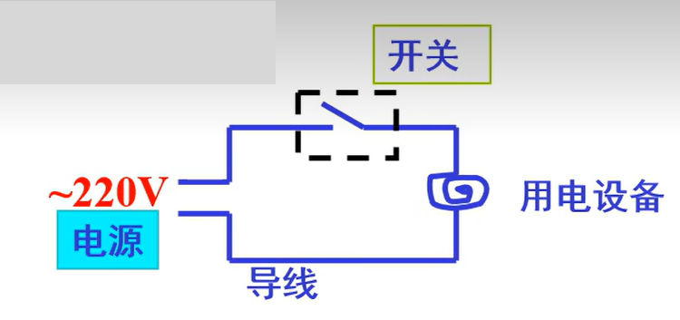

**(1) 电源**：为电路工作提供能量。

**(2) 用电设备或元器件 (负载)**：完成电路功能。

**(3) 中间环节**：连接电源和用电设备的导线，控制电源接入的开关等

#### 二、电路的定义

通过开关、导线等中间环节将电源和负载连接起来构成电流的通路。

#### 三、电路的功能

1、**能量传输**：将电源的电能传输给用电设备 (负载)。

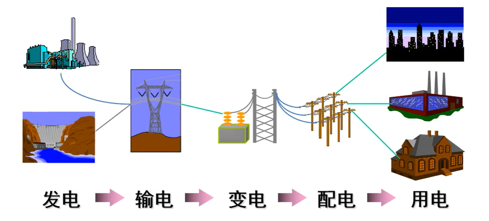

2、**能量转换**：将传输到负载的电能根据需要转换成其它形式的能量。 - 如光、声、热、机械能等。

电能 ---->(用电设备)----> 其它形式的能量

3、**信息传输**

4、**信息处理**

信号 (接受)---> 电路 ----> 信号 (已经放大、去噪、合成…)

#### 四、电路的分类

1、按电流类别分：

- 直流电路（DC: Direct Current circuit） 直流电路的电流的方向不变，但电流大小是可以改变的。电流的大小方向都不变的称为**恒定电流**。
- 交流电路（AC: Alternating Current circuit） 交流电路电流的大小和方向均随时间变化。

2、按处理信号分：模拟电路、数字电路

#### 五、电路模型

**1、元件模型** 

为了便于分析电路的主要特性和功能，把构成实际电路的元件抽象成理想的电路元件

元件模型是一种理想化模型：忽略元件的次要特性，用规定的理想化模型表征其物理特性。

**2、电路模型**

- 对电路中的每个元器件特性建立元件模型。
- 把所有元器件的元件模型按照原电路结构连接起来，形成电路的模型。

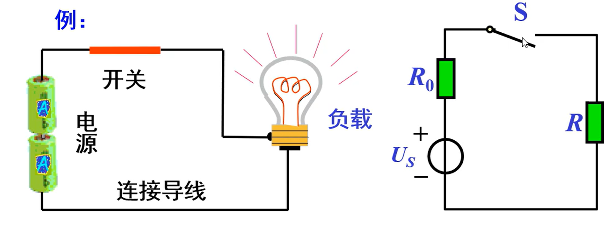

**常用的几种元件模型：**

在**集总**假设成立时，实际的电路元件就可以用一些模型来代替。或用模型的组合来代替。

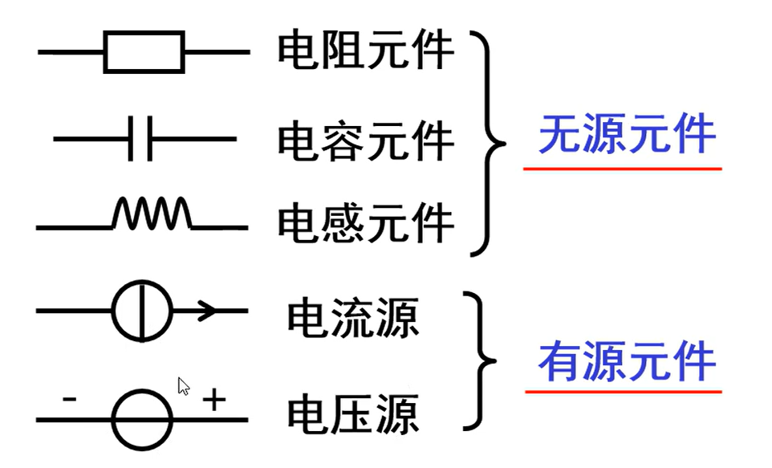

### 1.2 电流和电压的参考方向

#### 1.2.1 电流

##### 1、电流及其表示方式

**电流：** 电流是负电荷的定向运动形成的。

**定义：**单位时间流过电路中某一横截面的电荷量。

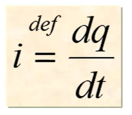

**电流符号：** `I`（不随时间变化）或 `i`（随时间变化）

**单位名称：** 安（培）符号：A（Ampere）

**电流的方向：** 规定正电荷流动的方向为电流的方向。

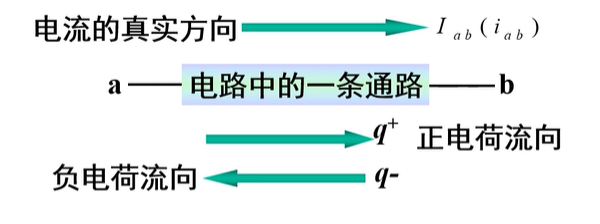

##### 2、电流的参考方向（Reference direction）

(1) **参考方向**：任意选定的一个方向即为电流的参考方向。

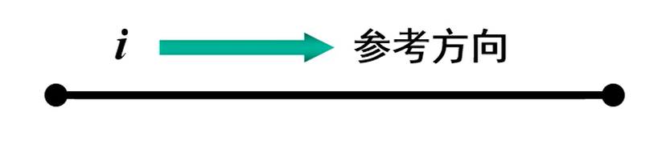

(2) **参考方向的任意性**

- 电流的参考方向是人为定义的。
- 不一定与实际方向相符。

##### 3、电流的参考方向与实际方向的关系

计算后：

- \(i>0\)：参考方向与真实方向一致
- \(i<0\)：参考方向与真实方向相反

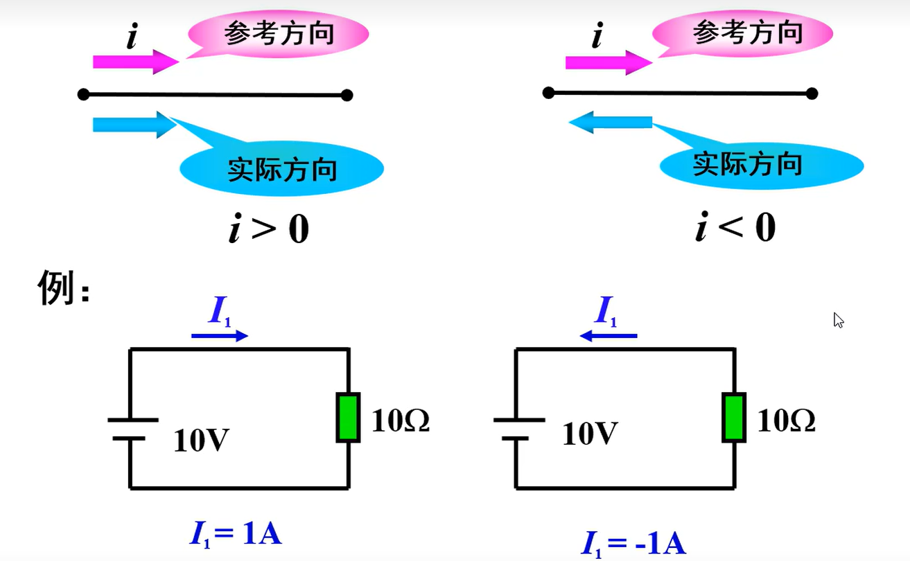

##### 4、电流参考方向的两种表示

用箭头表示：

用双下标表示：

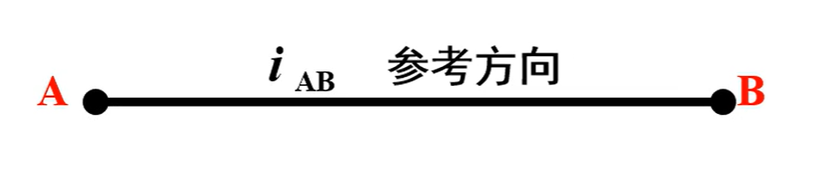

#### 1.2.2 电压

##### 1、电位

路中某点的电位等于该点与**参考点**之间的电压。

在电路中任选一节点，设其电位为零，此点称为参考点，亦称零电位点。

参考点用  表示

##### 2、电压及其表示方式

**电压的概念**：

- 电场是一种位场，**电荷在电场中具有电势能**。
- 单位正电荷在电场中某点所具有的电势能称为该点的**电位**。 它表示外力将单位正电荷从**参考点（零电位点）**移动到该点所作的功。

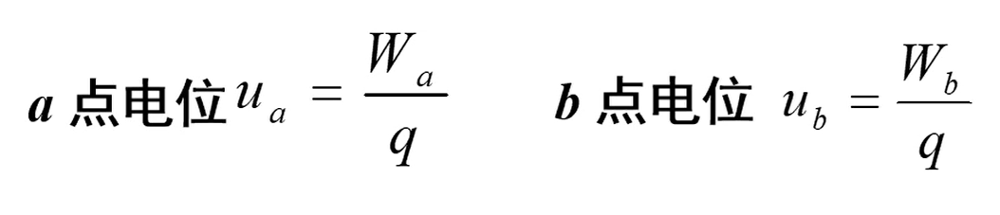

电路中两点（如a与b）之间的电位差称为**电压**。 

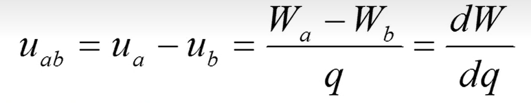   

- 单位名称：**伏 (特) (V)**

- 符号：用 `u` 或 `U` 表示

- **电压的真实方向：** 

  规定：**电位下降的方向**为电压的真实方向 

  即从 **高电位端** 指向 **低电位端**

**电动势的概念**

电源中的外力（非电场力）将单位正电荷从电源的负极移至正极所转换而来的电能。用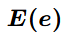表示。 单位：伏（V)。

电动势方向：电源**负极→正极**，即电位**升高**方向。

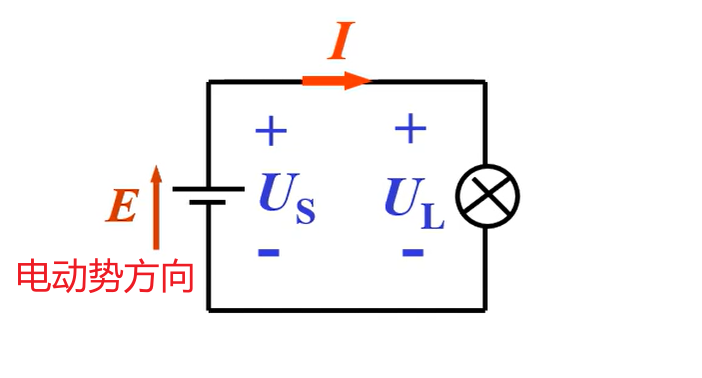

##### 3、电压的参考方向

- 电压具有**方向性**，不能单用数值来表示，必须同时标定其方向。
- 在对电路分析之前**不能确定**电压的真实方向。
- 两点之间电压只可能有两个方向，可**先假设**其中一个方向为电压的方向，称此假设的方向为**电压的参考方向**。

##### 4. 电压参考方向的表示方式

(1) **用正负极性表示**：由正极指向负极的方向为电压（降低）的参考方向。

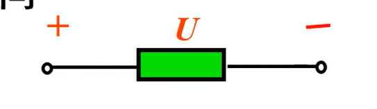

(2) **用箭头表示**：箭头指向为电压（降）的参考方向。

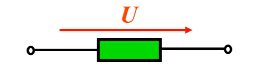

(3) **用双下标表示**：如\(U_{AB}\)，由 A 指向 B 的方向为电压（降）的参考方向。

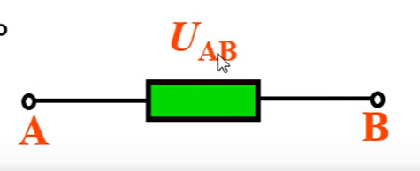

##### 5. 实际方向与参考方向的关系

- 当参考方向设得与真实方向一致时，电压的代数值符号为正；反之为负。
- 若分析电路后确定的电压符号为正，则表明电压的真实方向就是参考方向；反之亦然。

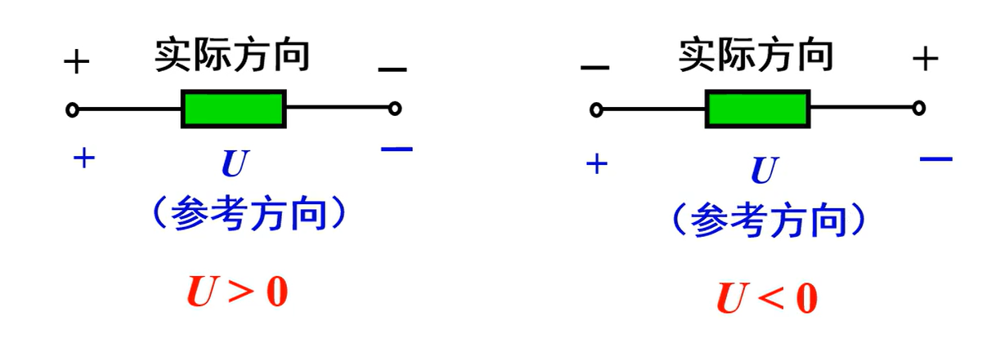

##### 电位、电压的计算

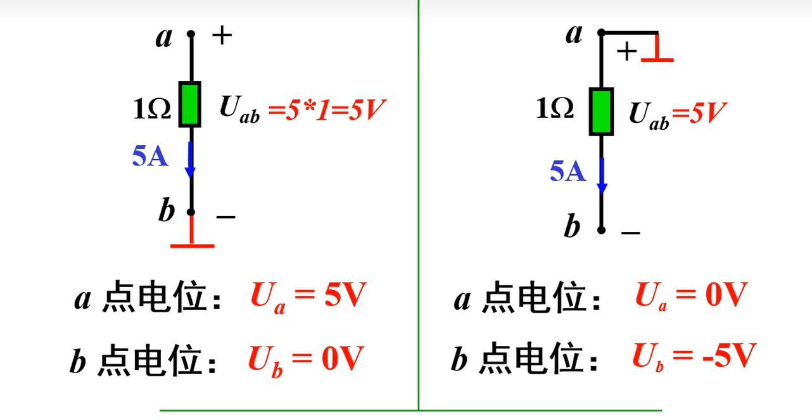

**结论：**电路中**某点的电位与参考点（接地点）的选择有关**；

##### 电位和电压的区别

**电压**：电路中两点间的电位差。

电位值是**相对的**，参考点选得不同，电路中其它各点的电位也将随之改变； 

电路中两点间的**电压值是固定的**，不会因参考点的不同而改变。

##### 电位在电路中的表示法

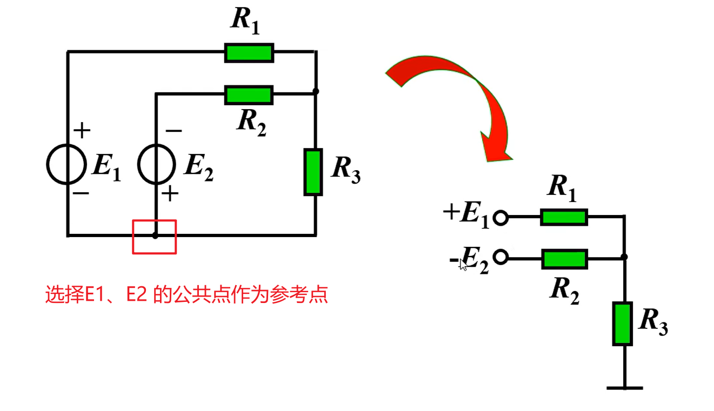

##### 例题

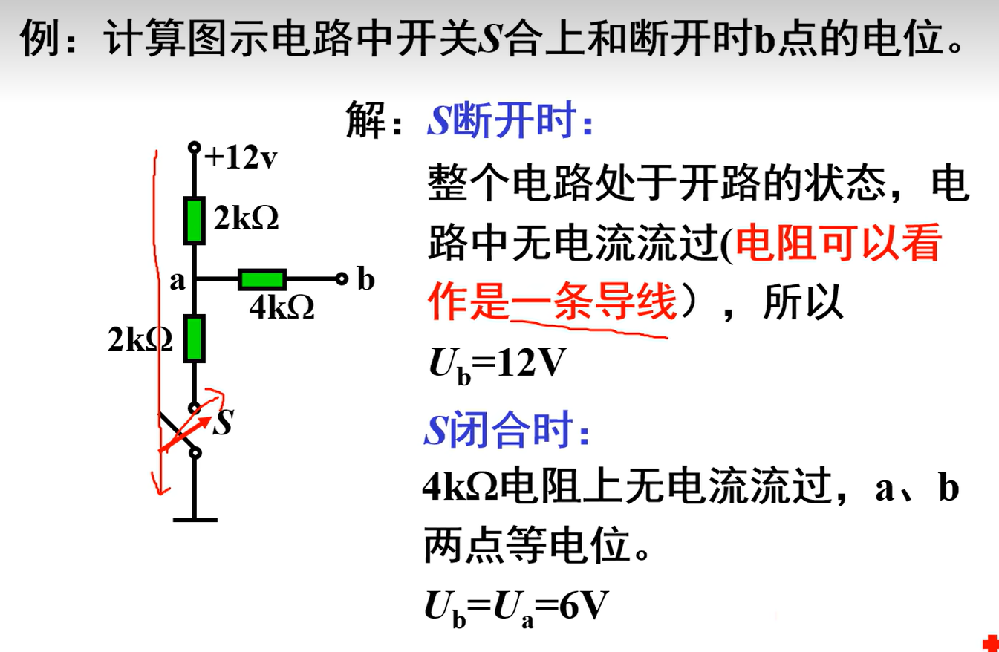

### 1.3 电功率和能量

#### 1.3.1 电功率

##### 1、电功率的概念、符号与单位

**电功率**：单位时间内电场力所做的功。

电功率是电路元件消耗电能快慢的度量，它表示单位时间内电路元件消耗的电场能量。

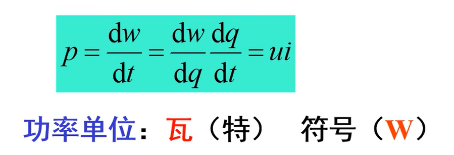

##### 2、功率的计算和判断

1）`u`,`i` 取**关联参考方向**

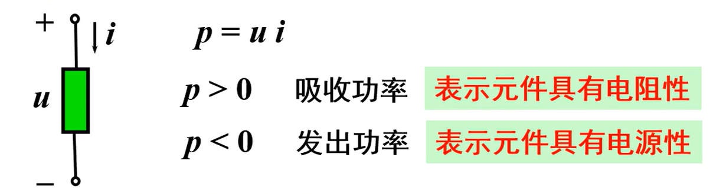

2）`u`,`i` 取**非关联参考方向**

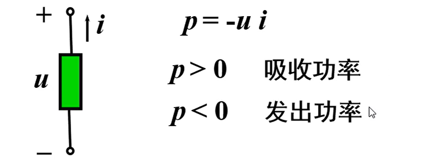

例题：

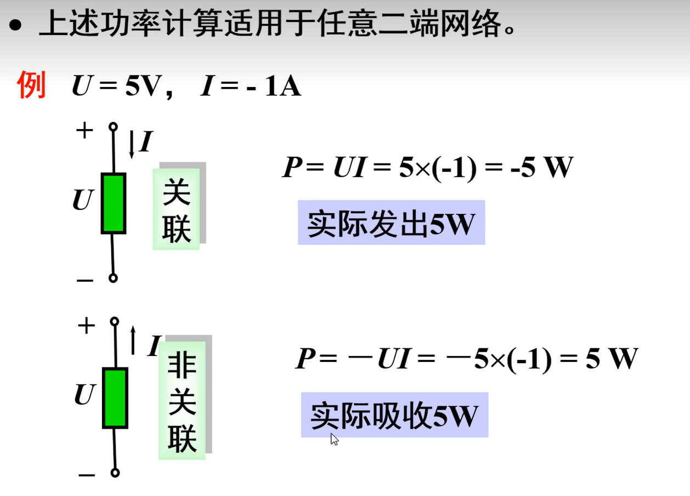

#### 1.3.2 能量（Energy）

能量：某段时间内电路消耗的功率。

公式：`W=Pt`

若功率随时间变化，则表示为：

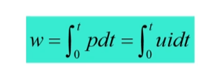

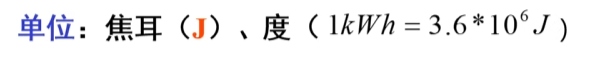

### 1.4 电路元件

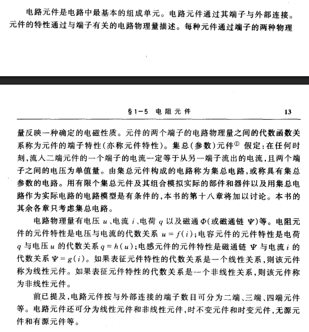

### 1.5 电阻元件（Resistor）

##### 1、符号

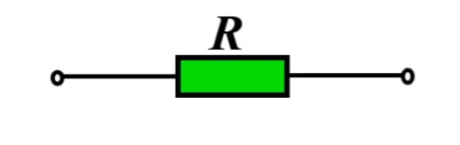

##### 2、伏安特性曲线

- 线性电阻元件的伏安特性为一条过原点的直线。
- 线性电阻元件的参数为特性曲线的斜率，记作 `R`。

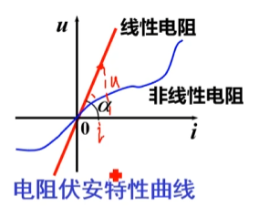

##### 3、欧姆定律

**（1）关联参考方向**

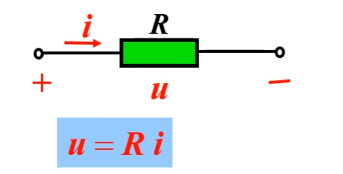

电阻单位：欧 (姆) 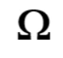

令 \(G=1/R\) G 称为电导

单位：西 (门子)  S (Siemens)

则欧姆定律表示为 `i=Gu`

**（2）非关联参考方向**

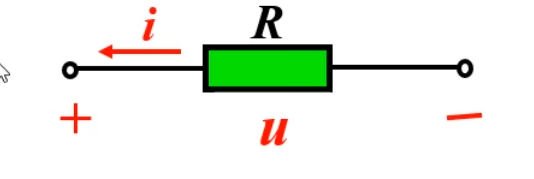

欧姆定律写为 

`u=-Ri`

或 `i=-Gu`

##### 4、功率

p > 0、w > 0 电阻是一种耗能元件

电阻属于无记忆元件

是一种无源元件

### 1.6 电压源和电流源（Independent Source）

#### 1.6.1 电压源

 1、符号

